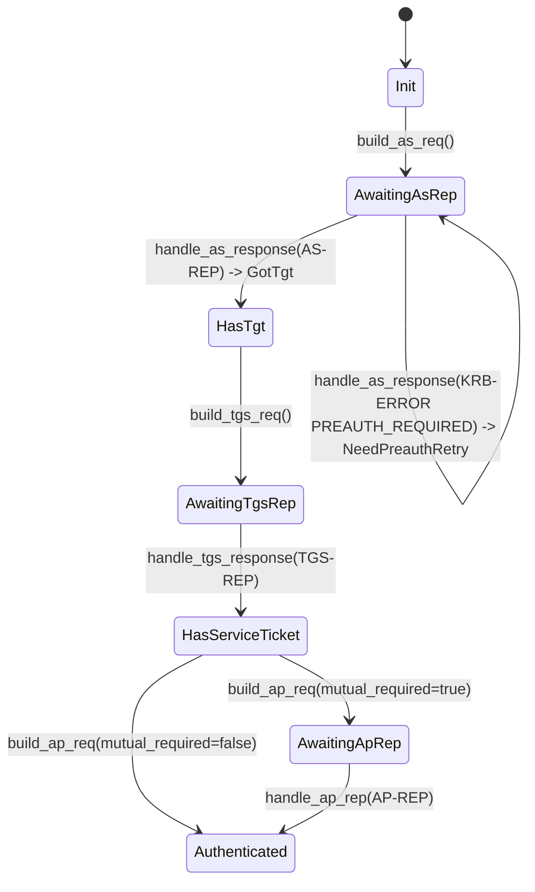
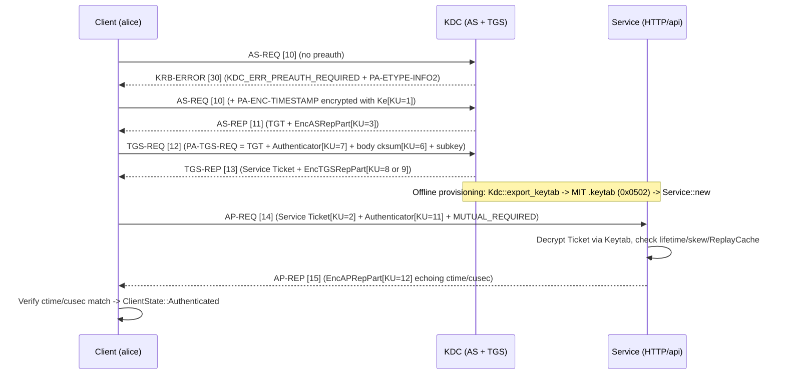

# Architecture Guide — `CoolrfulDARkness/moonkrb5`

This document describes the internal architecture, security boundaries, cryptographic constructions, and wire formats of `CoolrfulDARkness/moonkrb5`.

---

## 1. Layered Package DAG

`moonkrb5` is organized as a strict acyclic dependency graph of pure MoonBit packages with zero FFI bindings:

```text
  asn1 ◄───────────────────────┐
   ▲                           │
   │                           │
  types    crypto    keytab    │
   ▲         ▲         ▲       │
   └─────────┼─────────┴───────┤
             │                 │
          protocol ────────────┘
             ▲
             │
       moonkrb5 (root facade)
             ▲
             │
         cmd/main (CLI)
```

| Package | Responsibility | External Deps |
| :--- | :--- | :---: |
| `asn1` | Strict canonical DER TLV encoder/decoder, `SeqReader`, `[APPLICATION 1..30]` constants, `GeneralizedTime` validator | None |
| `crypto` | SHA-1/256/384, HMAC, PBKDF2, AES-128/256 CBC-CTS (CS3), RFC 3961 `n-fold`/DR/DK, RFC 8009 `KDF-HMAC-SHA2`, `ct_eq`, `DeterministicRng` | None |
| `keytab` | MIT Kerberos 5 `.keytab` (`0x0502`) binary serialization/deserialization & principal/etype/kvno lookup | None |
| `types` | RFC 4120 ASN.1 data models (`Ticket`, `KdcReq`, `KdcRep`, `ApReq`, `ApRep`, `Authenticator`, `KrbError`, `PaData`), Unix↔GeneralizedTime, TCP framing | `asn1` |
| `protocol` | Sans-I/O `Client`, `Kdc`, `Service`, `ReplayCache`, `Credential`, `ProtocolError` | `asn1`, `crypto`, `keytab`, `types` |
| `.` (root) | High-level facade (`version`, `HandshakeReport`, `run_full_handshake_demo`, `run_rfc_vector_self_check`, `run_security_defense_demo`) | all 5 packages |

---

## 2. Sans-I/O State Machines

All network I/O, wall-clock reads, and OS entropy calls are decoupled from the protocol core:
- Every protocol transition takes **raw DER `Bytes`**, an explicit **Unix timestamp (`Int64` seconds + `Int32` microseconds)**, and an explicit **`@crypto.DeterministicRng`**.
- The protocol returns **raw DER `Bytes`** (or typed `ProtocolError`) ready to be framed over TCP (`@types.encode_tcp_frame`) or sent over UDP/HTTP.

### Client Finite State Machine (`ClientState`)



### Three-Party Wire Exchange Flow



---

## 3. Strict ASN.1 DER Defense Boundary

ASN.1 parsing bugs (BER ambiguity, integer/length malleability, recursive stack exhaustion) are a historic source of Kerberos vulnerabilities. `asn1` enforces **strict canonical DER** at the outer boundary before any cryptographic or state-machine logic executes:

| Attack / Non-Canonical Form | Example Wire Bytes | Enforced Error |
| :--- | :--- | :--- |
| BER indefinite-length encoding | `30 80 ... 00 00` | `DerError::IndefiniteLength` |
| Non-minimal length (long form for `< 128`, or leading `0x00` length bytes) | `04 81 01 41`, `04 82 00 80 ...` | `DerError::NonCanonicalLength` |
| Non-minimal two's-complement integer (redundant `0x00`/`0xFF` sign byte) | `02 02 00 01`, `02 02 ff 80` | `DerError::NonCanonicalInteger` |
| Non-canonical BOOLEAN (anything other than `0x00` or `0xFF`) | `01 01 01` | `DerError::NonCanonicalBoolean` |
| Invalid `BIT STRING` (unused bits `> 7`, empty with unused `> 0`, non-zero pad bits) | `03 02 08 00`, `03 02 01 01` | `DerError::InvalidBitString` |
| Trailing unconsumed bytes after root TLV | `05 00 ff` | `DerError::TrailingBytes(1)` |
| Deeply nested constructed TLVs (`depth > 64`) | 65+ nested `SEQUENCE`s | `DerError::MaxDepthExceeded` |
| Invalid `GeneralizedTime` (fractional seconds, missing `Z`, invalid calendar/leap date) | `20230229120000Z` | `DerError::InvalidGeneralizedTime` |
| Unordered or unknown context-tagged fields in `SEQUENCE` | out-of-order `[n]` tags | `SeqReader` (`TagMismatch` / `MissingField`) |

RFC 4120 explicitly wraps protocol structures in constructed `[APPLICATION n]` (`0x60 | n`) and `[CONTEXT n]` (`0xA0 | n`) tags. `asn1` supports both short tags (`0..30`) and high-tag-number multi-octet encodings (`>= 31`).

---

## 4. Cryptographic Architecture: RFC 3962 vs. RFC 8009

`crypto` implements all primitives in pure MoonBit (`SHA-1`, `SHA-256`, `SHA-384`, `HMAC`, `PBKDF2`, `AES-128`, `AES-256`, `CBC-CTS CS3`) and contrasts the two Kerberos AES encryption families cleanly:

| Dimension | RFC 3962 (`etype 17 / 18`) | RFC 8009 (`etype 19 / 20`) |
| :--- | :--- | :--- |
| **Enctypes** | `aes128-cts-hmac-sha1-96` (17), `aes256-cts-hmac-sha1-96` (18) | `aes128-cts-hmac-sha256-128` (19), `aes256-cts-hmac-sha384-192` (20) |
| **String-to-Key (S2K)** | `PBKDF2-HMAC-SHA1(pass, salt, iter=4096)` → `DK(tkey, "kerberos")` | `PBKDF2-HMAC-SHA2(pass, etype_name \|\| 0x00 \|\| salt, iter=32768)` → `KDF-HMAC-SHA2(tkey, "kerberos")` |
| **Subkey Derivation** | RFC 3961 `n-fold(constant, 128)` → AES-ECB loop (`DR`/`DK`) | NIST SP 800-108 Counter Mode `KDF-HMAC-SHA2(K, label, context, L)` |
| **AEAD Composition** | **Encrypt-and-MAC**: `H = Trunc96(HMAC-SHA1(Ki, conf \|\| P))`, `C = AES-CTS(Ke, IV=0, conf \|\| P) \|\| H` | **Encrypt-then-MAC**: `C0 = AES-CTS(Ke, IV=0, conf \|\| P)`, `H = Trunc(HMAC-SHA2(Ki, IV \|\| C0))`, `C = C0 \|\| H` |
| **Decryption Safety** | Decrypts CTS first, then compares `H` using constant-time `ct_eq` | **Verifies `H` with `ct_eq` over `(IV \|\| C0)` BEFORE decrypting `C0`** |
| **KeyUsage Labels** | `be32(usage) \|\| 0xAA` (`Ke`), `0x55` (`Ki`), `0x99` (`Kc`) | `be32(usage) \|\| 0xAA` (`Ke`), `0x55` (`Ki`), `0x99` (`Kc`) with SHA-256/SHA-384 |
| **Default Checksum** | `hmac-sha1-96-aes128` (15) / `hmac-sha1-96-aes256` (16) | `hmac-sha256-128-aes128` (19) / `hmac-sha384-192-aes256` (20) |

### AES-CBC-CTS (Kerberos CS3 Variant)
- Plaintext is prefixed with a 16-byte random `confounder` (so `len >= 16` always holds for Kerberos messages).
- When `len == 16`, CS3 reduces to a single AES-CBC block.
- When `len > 16`, standard CBC runs through block `n-2`; the final two blocks (`P_{n-1}`, `P_n`) undergo ciphertext stealing and are **always swapped** (`E(P_n || tail)` followed by truncated `C_{n-1}`), matching RFC 3962 Appendix B even when `len` is an exact multiple of 16 bytes.

### KeyUsage Domain Separation
Every Kerberos encrypted or checksummed artifact binds a distinct 32-bit `KeyUsage` (`KU_AS_REQ_PA_ENC_TIMESTAMP = 1` through `KU_KRB_SAFE = 15`) into the key derivation input. Attempting to decrypt an `AP-REQ` authenticator (`KU = 11`) as an `AP-REP` encrypted part (`KU = 12`) derives completely unrelated `(Ke, Ki)` keys and fails with `CryptoError::IntegrityCheckFailed`.

---

## 5. MIT `.keytab` v0x0502 Binary Layout

The `keytab` package implements the standard MIT Kerberos 5 file format (`0x0502`), enabling key export from `Kdc::export_keytab` and ingestion by `Service::new` (as well as interoperability with standard `ktutil` / MIT krb5 tooling):

```text
+-------------------------------------------------------------------+
| File Header (2 bytes)                                             |
|   0x05  0x02   (Major version 5, Minor version 2, big-endian)     |
+-------------------------------------------------------------------+
| Repeated Entries until EOF:                                       |
|   int32  size         > 0 : active entry of `size` bytes          |
|                       < 0 : deleted hole of `|size|` bytes (skip) |
|                       == 0: invalid (`InvalidEntrySize`)          |
|   uint16 num_components   (v0x0502 count excluding realm)         |
|   counted_string realm    (uint16 len + UTF-8 bytes)              |
|   counted_string components[num_components]                       |
|   uint32 name_type        (e.g., NT_PRINCIPAL=1, NT_SRV_INST=2)   |
|   uint32 timestamp        (Unix seconds)                          |
|   uint8  vno8             (legacy 8-bit kvno; 0 if > 255)         |
|   uint16 etype            (e.g., 17, 18, 19, 20)                  |
|   uint16 keylen + key[keylen]                                     |
|   [optional uint32 vno32] (MIT extension when >= 4 bytes remain)  |
+-------------------------------------------------------------------+
```

Lookup semantics (`Keytab::find_key` / `get_key`):
- When `kvno` is specified (`Some(v)`), requires an exact match on `(realm, components, etype, kvno)`.
- When `kvno` is omitted (`None`), selects the matching entry with the **highest `kvno`** (supporting zero-downtime key rotation).

---

## 6. Replay Cache & Clock Skew Policy

`ReplayCache` protects both KDC (`PA-ENC-TIMESTAMP` & `TGS-REQ`) and `Service` (`AP-REQ`):
1. Incoming timestamps (`patimestamp` or `Authenticator.ctime`) are checked against `|now - client_time| <= max_skew_secs` (default `300s`); violations raise `ProtocolError::ClockSkew`.
2. Expired cache entries older than `now - max_skew_secs` are pruned automatically.
3. Uniqueness is keyed on `(crealm, cname, ctime, cusec)`; any duplicate within the skew window raises `ProtocolError::ReplayDetected` (translated by KDC into `KRB-ERROR(KRB_AP_ERR_REPEAT)`).

---

## 7. Multi-Target Compilation Guarantees

Because `moonkrb5` uses only MoonBit standard library primitives (no C FFI, no JS externs, no OS syscalls), CI verifies the entire workspace with `-d` (warnings as errors / strict diagnostics) on:
- **`wasm`** (WebAssembly MVP / linear memory)
- **`wasm-gc`** (WebAssembly GC, default preferred target)
- **`js`** (Node.js / Browser / Edge runtimes)
- **`native`** (C backend compiled with GCC/Clang)
