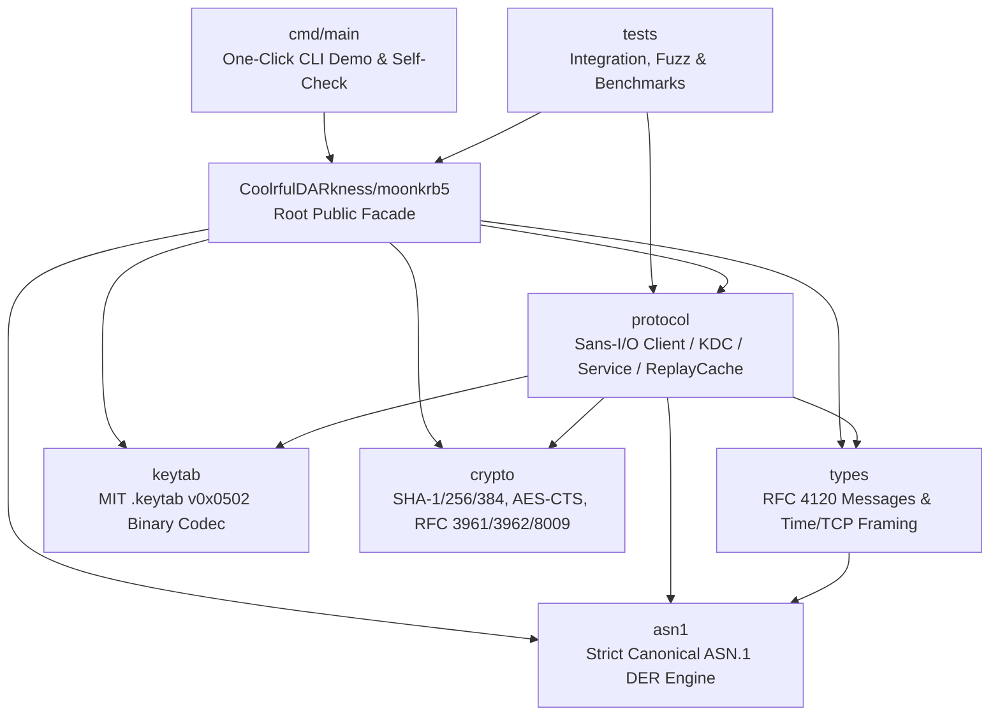

# CoolrfulDARkness/moonkrb5

> **Pure MoonBit · Zero-FFI · Sans-I/O Kerberos 5 Authentication Protocol Stack**  
> **纯 MoonBit · 零 FFI · Sans-I/O 企业级 Kerberos 5 认证协议栈（RFC 4120 / RFC 3961 / RFC 3962 / RFC 8009）**

[](LICENSE)
[](#multi-target-verification)
[](#key-highlights--项目亮点)

`moonkrb5` is a ground-up, zero-dependency implementation of the **Kerberos V5** authentication protocol in **MoonBit**. Every layer—from SHA-1/SHA-256/SHA-384, AES-CBC-CTS (CS3), PBKDF2, RFC 3961 `n-fold`, and RFC 8009 `KDF-HMAC-SHA2`, through strict ASN.1 DER parsing, MIT binary `.keytab` v0x0502 I/O, and the complete three-party **Client / KDC / Service** state machines—runs purely in MoonBit with **zero FFI** and **zero warnings** (`-d`) across `wasm`, `wasm-gc`, `js`, and `native` targets.

---

## Key Highlights / 项目亮点

- **100% Pure MoonBit & Zero-FFI（纯 MoonBit 零外部依赖）**: No OpenSSL, no libkrb5, no C shims, no JS polyfills. Compiles cleanly to WebAssembly (`wasm` & `wasm-gc`), JavaScript (`js`), and Native binaries from a single codebase.
- **Sans-I/O Protocol Core（纯函数式 Sans-I/O 状态机）**: All protocol entities (`Client`, `Kdc`, `Service`) accept and emit pure `Bytes` (DER wire messages) with explicit timestamp and `DeterministicRng` injection—enabling 100% deterministic testing, replay simulation, fuzzing, and seamless embedding in browsers, edge workers, proxies, or native daemons.
- **Full RFC Crypto Vector Verification（官方 RFC 密码测试向量全量验证）**: Verified byte-for-byte against official Appendix test vectors in **RFC 3961** (`n-fold`), **RFC 3962** (PBKDF2-HMAC-SHA1, DR/DK, AES-128/256-CTS), and **RFC 8009** (SP 800-108 `KDF-HMAC-SHA2`, AES-128-SHA256, AES-256-SHA384).
- **Hardened Against Real-World Attacks（安全纵深防御）**: Strict canonical DER decoder (rejects indefinite length, non-minimal lengths/integers, trailing bytes, depth > 64), constant-time MAC verification (`ct_eq`), KeyUsage isolation (`KU 1..15`), authenticator replay cache (`ReplayCache`), and configurable clock-skew enforcement.
- **MIT `.keytab` v0x0502 Compatibility（标准二进制密钥表互通）**: Full encoder/decoder for MIT Kerberos 5 binary keytab files, including 32-bit `kvno` extensions and negative deletion-hole records.

---

## Architecture & Package Topology / 架构与包依赖拓扑



```text
CoolrfulDARkness/moonkrb5
├── asn1/        Strict ASN.1 DER encoder/decoder & [APPLICATION 1..30] tags
├── crypto/      Pure MoonBit SHA-1/256/384, HMAC, PBKDF2, AES-CTS, RFC 3961/3962/8009, RNG
├── keytab/      MIT Kerberos 5 .keytab (v0x0502) binary reader/writer & key lookup
├── types/       RFC 4120 ASN.1 message models, PA-DATA, GeneralizedTime, TCP framing
├── protocol/    Sans-I/O Client FSM, KDC (AS+TGS), Service verifier, ReplayCache
├── moonkrb5.mbt Root facade (handshake demo, RFC vector self-check, security demo)
├── cmd/main/    One-click CLI runner (`moon run cmd/main`)
└── tests/       Cross-package integration tests, fuzzing & benchmarks
```

For deep design notes on state machines, DER boundaries, Encrypt-and-MAC vs. Encrypt-then-MAC, and `.keytab` wire layout, see **[ARCHITECTURE.md](ARCHITECTURE.md)**.

---

## RFC & Cipher Suite Coverage Matrix / 协议与加密套件覆盖矩阵

### Modern Encryption Suites (Etypes 17–20)

| Enctype ID | Name | Standard | Cipher / Mode | KDF | MAC Scheme | Key / MAC Size |
| :---: | :--- | :---: | :--- | :--- | :--- | :---: |
| `17` | `aes128-cts-hmac-sha1-96` | RFC 3962 | AES-128-CBC-CTS (CS3) | PBKDF2-SHA1 + `n-fold`/DK | Encrypt-and-MAC (HMAC-SHA1-96) | 16B / 12B |
| `18` | `aes256-cts-hmac-sha1-96` | RFC 3962 | AES-256-CBC-CTS (CS3) | PBKDF2-SHA1 + `n-fold`/DK | Encrypt-and-MAC (HMAC-SHA1-96) | 32B / 12B |
| `19` | `aes128-cts-hmac-sha256-128` | RFC 8009 | AES-128-CBC-CTS (CS3) | PBKDF2-SHA256 + KDF-HMAC-SHA2 | Encrypt-then-MAC (HMAC-SHA256-128) | 16B / 16B |
| `20` | `aes256-cts-hmac-sha384-192` | RFC 8009 | AES-256-CBC-CTS (CS3) | PBKDF2-SHA384 + KDF-HMAC-SHA2 | Encrypt-then-MAC (HMAC-SHA384-192) | 32B / 24B |

### RFC 4120 Protocol Exchanges & Messages

| Exchange / Feature | Application Tags & Structures | Status |
| :--- | :--- | :---: |
| **AS Exchange + Pre-Auth** | `AS-REQ [10]`, `AS-REP [11]`, `EncASRepPart [25]`, `PA-ENC-TIMESTAMP (2)`, `PA-ETYPE-INFO2 (19)` | ✅ Complete |
| **TGS Exchange** | `TGS-REQ [12]`, `TGS-REP [13]`, `EncTGSRepPart [26]`, `PA-TGS-REQ (1)`, subkey & body checksum | ✅ Complete |
| **AP Mutual Auth** | `AP-REQ [14]`, `AP-REP [15]`, `Authenticator [2]`, `EncAPRepPart [27]`, `AP_OPT_MUTUAL_REQUIRED` | ✅ Complete |
| **Tickets & Errors** | `Ticket [1]`, `EncTicketPart [3]`, `KRB-ERROR [30]`, `METHOD-DATA`, 4-byte TCP record framing | ✅ Complete |
| **MIT Keytab** | Format `0x0502`, big-endian records, deletion holes, 32-bit `kvno` extension, `Kdc::export_keytab` | ✅ Complete |

---

## Quick Start / 快速上手

### 1. Run the One-Click CLI Demo

```bash
# Run on default target (wasm-gc)
moon run cmd/main

# Or explicitly across WebAssembly, JavaScript, and Native
moon run --target wasm-gc cmd/main
moon run --target js cmd/main
moon run --target native cmd/main
```

The CLI executes three live verification stages:
1. **`[1/3]` RFC 3961 / 3962 / 8009 Cryptographic Self-Check** against official RFC test vectors.
2. **`[2/3]` Complete 3-Party Kerberos 5 Handshake** across all 4 encryption suites (`etype 17/18/19/20`) including pre-auth challenge, TGT & Service Ticket issuance, MIT `.keytab` binary round-trip, and mutual `AP-REQ`/`AP-REP` verification with exact DER byte counts.
3. **`[3/3]` Security Defense-in-Depth Demo** proving live interception of 5 core attack classes.

### 2. Run Tests & Benchmarks

```bash
# Multi-target zero-warning checks
moon check --target wasm -d
moon check --target wasm-gc -d
moon check --target js -d
moon check --target native -d

# Full unit + integration test suite
moon test --target wasm-gc -d
moon test --target js -d
moon test --target native -d

# Build / run benchmarks
moon bench --target wasm-gc --build-only -d
```

### 3. Embed in Your MoonBit Project

```moonbit
///|
fn authenticate_example() -> Unit raise @protocol.ProtocolError {
  let etype = @crypto.Enctype::Aes256CtsHmacSha384_192
  let report = @moonkrb5.run_full_handshake_demo(etype)
  println("Authenticated \{report.client_principal} -> \{report.service_principal}")
  println("Mutual auth: \{report.mutual_authenticated}, AP-REQ: \{report.ap_req_bytes}B")
}
```

Or wire the Sans-I/O state machines directly over your own TCP/UDP/HTTP transport:

```moonbit
let client = @protocol.Client::new(
  @types.PrincipalName::user("alice"),
  "EXAMPLE.COM",
  b"secret-password",
  preferred_etypes=[@crypto.Enctype::Aes256CtsHmacSha384_192],
)
let as_req_der = client.build_as_req(now_unix_secs, rng)
// Send `as_req_der` over your transport, feed KDC reply bytes back:
match client.handle_as_response(now_unix_secs, usec, rng, kdc_reply_der) {
  @protocol.AsStepResult::NeedPreauthRetry(retry_der) => { /* send retry_der */ }
  @protocol.AsStepResult::GotTgt(tgt_cred) => { /* call client.build_tgs_req(...) */ }
}
```

---

## Security Features Checklist / 安全特性清单

- [x] **Constant-Time Tag Verification**: All HMAC/checksum comparisons use branchless XOR accumulation (`@crypto.ct_eq`) to prevent timing side-channels.
- [x] **Strict Canonical ASN.1 DER**: Rejects BER indefinite lengths (`0x80`), non-minimal length encodings, non-canonical two's-complement integers, non-`0x00`/`0xFF` booleans, invalid `BIT STRING` padding bits, trailing garbage bytes, malformed `GeneralizedTime` dates, and nesting depth > 64.
- [x] **Cryptographic KeyUsage Separation**: Distinct derived keys (`Ke`/`Ki`/`Kc`) per RFC 4120 KeyUsage (`KU_AS_REQ_PA_ENC_TIMESTAMP=1` through `KU_KRB_SAFE=15`), preventing cross-message ciphertext splicing or reflection.
- [x] **Authenticator Replay Cache**: `ReplayCache` tracks `(crealm, cname, ctime, cusec)` tuples across both KDC (`PA-ENC-TIMESTAMP`, `TGS-REQ`) and `Service` (`AP-REQ`), rejecting duplicate authenticators with `ReplayDetected` / `KRB_AP_ERR_REPEAT` and pruning expired entries.
- [x] **Clock Skew & Ticket Lifetime Validation**: Enforces configurable `max_skew_secs` (default 300s), ticket `starttime`/`endtime`, `TKT_FLAG_INVALID`, nonce matching, principal/realm binding, and `KDC-REQ-BODY` integrity checksums.

---

## License

Licensed under the **Apache License, Version 2.0**. See [LICENSE](LICENSE) for full details.
